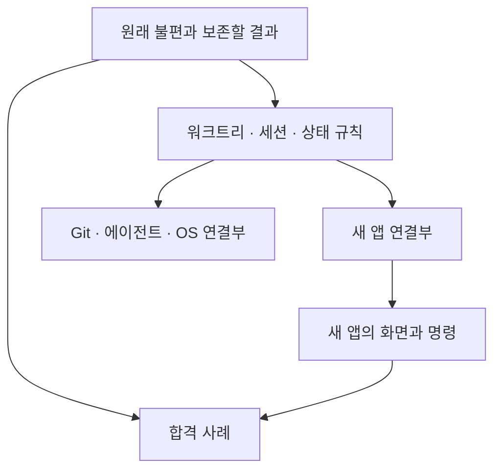

# 다른 앱으로 작업 흐름 옮기기

목표는 **Herdr에서 해결한 불편을 다른 앱에서도 다시 겪지 않는 것**이다. 같은 모양의 mod를 전부 복제하는 것이 아니다. 새 앱의 기본 기능으로 해결되면 그것을 쓰고, 빠진 규칙과 연결만 구현한다.

이 문서는 기존 [WHY 목차](../WHY.md)와 기능별 `WHY.md`를 대체하지 않는다. **왜 생겼는지는 기존 WHY가 기준**이며, 여기서는 기능 누락 방지, 구체적인 동작, 데이터 이전, 검증 방법을 보완한다. 기존 기록에 없는 과거 사용자 요구를 추측해서 역사적 사실로 적지 않는다.

## 기준과 적용 범위

- 기준 코드: `898a2c3ffe690fea307ae0b8c2856bcc25f666f1` (2026-11-09).
- 이후 추가: C03 UI 오류 기록(`hm logs`, 2026-11-09). 기준 코드에 이미 있던 기능으로 간주하지 않는다.
- 현재 호스트 관찰: Herdr 0.1.13. `upstream/versions.json`의 0.1.12는 복제한 기본 mod를 마지막으로 병합한 버전이며, 실행 중 앱 버전과 다르다.
- 대상: 8개 번들, 12개 mod, `hm`·`hm-statusline`, Herdr·세션 번역 스킬, 공유 라이브러리, 설치·업스트림 갱신 흐름.
- Herdr 자체의 터미널 에뮬레이터·SSH·탭·분할·테마 엔진을 재구현하는 명세는 아니다. 새 앱이 제공하거나 [호스트 연결 계약](host-contract.md)으로 충족해야 한다.
- 같은 컴퓨터의 다른 앱으로 옮기는 것이 우선이다. 다른 컴퓨터로 옮기는 경우 Git worktree·절대경로·에이전트 저장소까지 다루는 추가 절차가 필요하다.

## 읽는 순서

1. [기능 목록](catalog.md)에서 원래 불편과 보존할 결과를 읽는다. 각 행의 WHY에 기존 배경과 걷어낼 조건이 있다.
2. 새 앱에서 각 기능을 `기본 지원 / 연결만 필요 / 별도 구현 / 지원 불가 / 의도적 제외`로 판정한다. 판정에는 실제 확인 방법을 적는다. 이름이 비슷하다는 이유만으로 기본 지원으로 판단하지 않는다.
3. 별도 구현하는 기능의 [동작 명세](behavior.md), [외부 연동](integrations.md), [데이터 이전](data.md)을 읽는다.
4. [화면·상호작용 기준](screens.md)과 [합격 사례](acceptance.md)를 새 앱에서 확인한다. 픽셀 일치보다 결과·포커스·상태·데이터 보존을 확인한다.

| 자료 | 역할 |
|---|---|
| [기존 기능별 WHY](../WHY.md) | 무엇이 불편했는지, 왜 만들었는지, 언제 없어져도 되는지 |
| [catalog.md](catalog.md) / [catalog.json](catalog.json) | 전체 기능 ID와 원래 문제, 보존할 결과, 담당 코드·검증 사례 연결 |
| [behavior.md](behavior.md) | 입력·기본값·실행 순서·실패·누락 기능 처리 |
| [host-contract.md](host-contract.md) | UI/터미널/저장소/머신을 새 앱 기능에 연결하는 경계 |
| [data.md](data.md) | 가져갈 값과 버릴 캐시, 경로·ID 변환, 이전 절차 |
| [integrations.md](integrations.md) | Git·GitHub·Claude·Codex·OS와 주고받는 명령과 데이터 |
| [screens.md](screens.md) | 화면 상태, 너비, 키보드, 포커스, 캡처 절차 |
| [acceptance.md](acceptance.md) / [acceptance.json](acceptance.json) | 기능별 준비·행동·기대 결과. 작성됨과 실행 통과를 구분 |
| [fixtures/README.md](fixtures/README.md) | 실사용 정보가 없는 이전·한도·상태·세션 예제 |

## 그대로 가져갈 것과 교체할 것

- **보존:** 같은 작업공간 식별, 사용자 메타데이터, 삭제 보호, Sleep·복구 의미, 에이전트 상태 구분, 버튼과 CLI의 결과 일치, 문서 열 때의 포커스, 사용량 출처와 오래된 값의 표시.
- **교체:** `herdr`/`gpui-kit` import, `space`/`tab`/`pane` ID, 레이아웃 블록, 메뉴·단축키 등록, `hc` 호출, 로컬 저장소 접근, 앱 활성 상태·OS 알림 연결.
- **기본 기능에 흡수 가능:** 새 앱의 프로젝트 트리·세션 목록·복구·문서 뷰어·한도 표시가 합격 사례를 만족하면 해당 mod 구현을 생략한다.
- **자동 재사용 아님:** `lib/*.js`도 현재는 `herdr`를 import한다. 이미 호스트 독립 SDK로 분리됐다는 뜻이 아니다. Python 수집기 일부는 독립 실행 가능하지만 OS·에이전트 형식 의존이 있다.

## 이식 작업 순서

1. 기준 버전과 새 앱 버전을 고정하고 기능 목록에 지원 판정을 적는다.
2. 사용자 데이터 사본과 이전 계획을 만든다. 원본 워크트리·세션·설정은 이 단계에서 변경하지 않는다.
3. 저장소·실행·작업공간 열기·포커스·에이전트 상태 연결부터 마련한다.
4. 프로젝트/워크트리 → 메타데이터/사이드바 → 세션/Sleep/복구 → 검색/CLI → 한도/문서/알림/설정 순으로 연결한다. 새 앱 기본 기능이 있으면 그 단계는 검증만 한다.
5. 사례를 실행하고 `통과 / 실패 / 미실행 / 제외(이유)`를 기록한다. 기능을 제외하면 그 불편을 어떤 대안으로 해결하는지 적는다.
6. 기존 앱과 새 앱에서 같은 세션을 동시에 자동 복구하지 않도록 전환 주체를 하나로 정한다. 데이터 이전 완료와 검증 완료를 확인한 뒤 기존 앱 사용을 종료한다.

## 현재 구현과 목표 동작을 구별하기

이 문서의 `기준 동작`은 코드에서 확인한 내용이고, `이식 합격 기준`은 원래 불편이 해결됐다고 판정할 조건이다. 코드의 결함을 새 앱에 복제하지 않는다. 예를 들어 세션 창의 Resume은 실제 세션을 열어야 한다. 기준 코드에 실행을 막는 문제가 있더라도 “오류가 나야 동일”로 판정하지 않는다.

[behavior.md의 알려진 차이](behavior.md#알려진-차이와-검증-한계)에 코드에서 발견한 문제와 실측하지 않은 부분을 적었다. 합격 사례 문서의 존재는 새 구현의 검증 완료를 뜻하지 않는다.

## 갱신 규칙

기능을 바꿀 때는 먼저 그 기능 ID의 **불편·결과가 달라졌는지** 확인한다. 달라졌다면 WHY와 catalog를, 입력·데이터·상태가 달라졌다면 behavior/data/integrations와 예제를, 검증 방법이 달라졌다면 acceptance/screens를 함께 갱신한다. 기존 기능 ID는 이름 변경만으로 바꾸지 않는다. 기능을 제거하면 새 앱/기본 기능으로 대체된 근거를 남긴다.

문서 연결과 예제 검증: `python3 scripts/check-porting-docs.py`. 이것은 목차·사례·예제의 정합성 검사이며 호스트에서 실제 동작을 시험하는 도구는 아니다.
